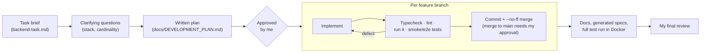

# AI-assisted development report

This project was built with an AI coding agent (Cursor's agent mode) acting as the
programmer, under engineering direction and review by me. This report describes the workflow,
what context and tasks the agent received, how its output was reviewed and validated, and where
the line between delegated work and retained decisions was drawn.

## 1. Workflow

1. **Plan before code.** The agent read the brief and asked only the questions it could not settle
   itself: database/ORM (I chose PostgreSQL + Prisma) and the product–category cardinality (I chose
   many-to-many). It then wrote a full plan: architecture, schema, endpoints, auth model, MCP tool
   list, test plan, branch plan. I approved it, and it is kept verbatim in
   [DEVELOPMENT_PLAN.md](DEVELOPMENT_PLAN.md) together with the deviations made later.
2. **One branch per concern**, merged into `main` with `--no-ff`: scaffold → database → auth/RBAC →
   audit → catalog → MCP server → Docker → tests → docs. The commit messages explain *why*, not just
   *what*, so the history doubles as a design log.
3. **Verify every step against reality**, not against the agent's own claims: compile, lint, start the
   service, call it, inspect the database. Each defect below was found that way.
4. **Guardrails stayed on.** Merges into `main` were stopped by the IDE's auto-review and needed my
   explicit approval each time. Prisma's built-in guard against AI agents running destructive commands
   (`migrate reset`) was respected rather than bypassed (it turned out not to be needed). The agent
   also left other projects on my machine alone (a Postgres container on 5432, a Node app on
   port 3000) and worked around them rather than stopping them.

## 2. Context and tasks given to the agent

| Context | Purpose |
| --- | --- |
| The full task brief | Requirements and evaluation criteria, read as acceptance criteria |
| My answers on stack and cardinality | Fixed the two choices that shape everything else |
| "Act as a senior backend developer; plan first, then run the plan" | Expected quality bar and process |
| The approved plan | Scope contract for the implementation phase |
| Feedback on intermediate results | Course corrections (e.g. "continue", approvals) |

Tasks delegated to the agent as **programmer**:

- Scaffolding the workspace, configs, lint/test setup.
- Writing the Prisma schema, migrations (including the hand-written CHECK constraints and audit
  trigger), and an idempotent seed.
- Implementing modules, DTOs, guards, the audit pipeline, error mapping, Swagger annotations.
- Implementing the MCP server: tool definitions, HTTP client, both transports.
- Dockerfiles, compose stack, containerised test runner.
- Writing the test suites and the documentation drafts, including this report's evidence sections.
- Running everything, diagnosing failures, and fixing them.

## 3. Engineering decisions retained by me

The agent proposed options with trade-offs; these choices were mine:

| Decision | Choice |
| --- | --- |
| Database and ORM | PostgreSQL + Prisma |
| Product ↔ category relationship | Many-to-many |
| Overall plan and scope | Approved before implementation |
| What merges into `main` | Every merge individually approved |
| Final acceptance | My review of code, docs and history |

Decisions the agent made inside the approved plan, and which I reviewed as an engineer would
review a colleague's design choices (rationale in [DECISIONS.md](DECISIONS.md)):

- MCP server as a separate process that calls the REST API with the agent's own key, so it
  cannot bypass the API by construction.
- Permission-based RBAC; API keys (SHA-256, scoped, revocable) for agents and JWT for humans; agents
  can never hold `API_CLIENTS_MANAGE`.
- Audit entries written in the same transaction as the change, failures audited too, the MCP
  channel trusted only from agents, the log made append-only by a trigger.
- Row locks for link operations, 422 for unknown references, both incremental and declarative
  link endpoints.
- Pinning Nest 11 / Prisma 6 instead of the newest majors, and accepting the documented
  `npm audit` advisories for now.

## 4. How generated code was reviewed and validated

**Layers of validation, from cheapest to strongest:**

1. **Static:** strict TypeScript (`tsc --noEmit`) and ESLint (`no-explicit-any` as error) in both
   workspaces, clean.
2. **Schema:** `prisma migrate diff --exit-code` confirmed the migrations match the schema with no
   drift. CHECK constraints and the immutability trigger were exercised directly with SQL.
3. **Manual smoke runs** against the running API and the MCP server (stdio and HTTP): status codes,
   error envelopes, audit rows and Swagger output.
4. **Automated tests:** 262 tests (71 unit, 174 REST e2e, 17 MCP e2e) against a real PostgreSQL. The
   authorization tests are an exhaustive endpoint × principal matrix, and the MCP tests drive the
   official SDK client through the real stack.
5. **Reproducibility:** the full suite also passes inside Docker
   (`docker compose --profile test run --rm tests`), and the production images were started and
   smoke-tested (migrations, seed, login, RBAC, MCP over HTTP).

**Defects caught by this process** (all fixed, and most now covered by tests):

| Found by | Defect | Fix |
| --- | --- | --- |
| Version check | The `latest` tags were a Prisma 8 release candidate and a just-released Nest 12 | Pinned the stable lines (Prisma 6.19, Nest 11.2) |
| Smoke test | Seeded passwords containing `#` were truncated (dotenv treats `#` as a comment), so login failed | Changed the seed passwords; documented it |
| Smoke test | Requests "to the API" returned another app's 404s: a different local project listened on `[::]:3000` | Defaulted MCP/API URLs to `127.0.0.1`; moved compose Postgres to 5433 |
| Smoke test | Malformed JSON errors carried `requestId: null` (the body parser fails before the request-id middleware) | The exception filter mints an id when missing |
| Smoke test | Arabic category names produced an **empty slug** | Unicode-aware slugify, plus a migration relaxing the slug CHECK |
| e2e test | Unicode normalisation folds `إ` into `ا`, so spelling variants share one slug | Accepted as desirable (prevents near-duplicates); now asserted by a test |
| e2e test | Expected-value mistakes in the tests themselves (permission matrix, field order) | Fixed the tests after confirming the code was right, not the other way round |
| Typecheck | Untyped `catch` values in the MCP unit tests | Typed rejection helper |
| Docker build | Flaky network: `apk` I/O errors, DNS failures, `ECONNRESET` | Dropped `apk`; npm fetch retries; BuildKit cache mounts; retried builds |

**Review practices applied to agent output:**

- Treat the agent's own summaries as claims to verify, not as facts. Every "done" was backed by a
  command run and its output.
- When a test failed, decide first whether the *code* or the *test* was wrong, and record the
  reasoning (see the slug case above).
- Read every migration line by line. Generated SQL is where silent data loss lives.
- Check security-sensitive paths against a checklist: deny-by-default guard, no mass assignment,
  secrets never logged or audited, identical login failures, agents unable to escalate.
- Keep the MCP layer free of business logic. Any rule found in the MCP server would be a review
  finding, because rules belong in the API.

## 5. Observations

- **Where the agent was strongest:** breadth and consistency. It applied the same error envelope,
  DTO conventions, audit calls and Swagger annotations across every module, and wrote exhaustive
  test matrices that a human would probably sample instead.
- **Where human judgement mattered most:** scoping (what *not* to build: refresh tokens, soft
  delete, OAuth for MCP; all documented as next steps), choosing between defensible designs, and
  insisting on proof by execution.
- **What made the collaboration work:** an explicit plan up front, small reviewable branches,
  guardrails that force a human decision at integration points, and tests against real
  infrastructure instead of mocks.
