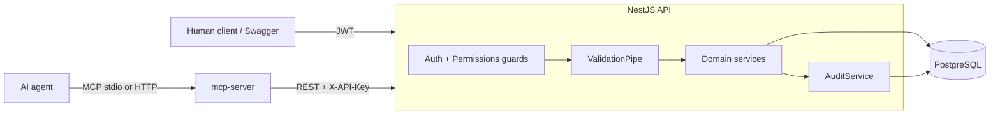

# Development Plan (as approved before implementation)

> This is the plan that was written and approved **before any code was written**.
> It is kept verbatim so reviewers can compare intent with the final result.
> Deviations made during implementation are listed at the bottom under
> "Refinements during implementation".

## Key decisions

- **Stack:** NestJS 11 + TypeScript, PostgreSQL 16, Prisma ORM (typed client, versioned SQL migrations, interactive transactions).
- **Relationship:** many-to-many products and categories through the `product_categories` join table, with a composite primary key and cascade on delete.
- **Human auth:** email/password (bcryptjs) issues short-lived JWT access tokens. Stateless, standard for REST, supported by Swagger.
- **Agent auth:** API keys for MCP agents (`zk_<prefix>_<secret>`). Only a SHA-256 hash is stored, keys can be revoked, and each key carries an explicit permission list (least privilege).
- **Authorization:** permission-based RBAC. Roles map to permissions: ADMIN gets read/write on products and categories; USER gets read permissions only. Agents get only the permissions assigned to them. Enforced by a single `PermissionsGuard` with a `@RequirePermissions()` decorator.
- **MCP architecture:** the MCP server is a separate process that calls the REST API using the agent's own API key. Every MCP action therefore goes through the same guards, validation pipes, services, transactions and audit logging. This structurally meets the "must not bypass" requirement.
- **Audit:** a successful mutation writes its audit row inside the same DB transaction, so the log matches what actually happened. Denied or failed write attempts are logged as FAILURE.



## Repository layout

```
/package.json            npm workspaces root (api, mcp-server), root scripts
/docker-compose.yml      postgres + api (+ mcp-server http mode), healthchecks
/.env.example
/api                     NestJS app
  prisma/schema.prisma, prisma/migrations/, prisma/seed.ts
  src/config  src/prisma  src/common  src/auth  src/users  src/api-clients
  src/categories  src/products  src/audit  src/health
  test/                  e2e specs (supertest + MCP integration)
  Dockerfile
/mcp-server              @modelcontextprotocol/sdk, zod schemas
  src/server.ts (createMcpServer factory), src/api-client.ts, src/tools/*, src/index.ts
  Dockerfile
/docs                    ERD.md, DECISIONS.md, MCP.md, AI_DEVELOPMENT_REPORT.md,
                         DEVELOPMENT_PLAN.md (this file), openapi.json
```

## Database

- `users`: uuid PK, `email` UNIQUE, `password_hash`, `name`, `role` enum(ADMIN, USER), `is_active`, timestamps.
- `api_clients`: uuid PK, `name`, `key_prefix` UNIQUE, `key_hash`, `permissions` enum[], `last_used_at`, `revoked_at`, `created_by_id` FK users.
- `categories`: uuid PK, `name`/`slug` UNIQUE, `description` text NOT NULL, timestamps.
- `products`: uuid PK, `name`, `sku` UNIQUE, `description` text NOT NULL, `price` numeric(12,2) CHECK >= 0, `stock` int CHECK >= 0, `is_active`, timestamps; indexes on `name`, `created_at`.
- `product_categories`: PK(`product_id`,`category_id`), index on `category_id`, `assigned_at`, both FKs ON DELETE CASCADE.
- `audit_logs`: action, resource type/id, actor type/id/label, channel (REST/MCP), status (SUCCESS/FAILURE), `changes` jsonb (before/after), `metadata` jsonb, `request_id`, `ip`, `created_at`; indexes on (resource_type, resource_id), actor, created_at.

## REST API (`/api/v1`, Swagger at `/api/docs`)

- `auth`: register (always USER), login (rate-limited), me.
- `categories`: list (pagination, search), get (with products), create (optional `productIds`), PATCH, DELETE, plus relationship endpoints.
- `products`: list (pagination, search, `categoryId` filter), get (with categories), create/PATCH with `categoryIds`, DELETE.
- `api-clients` (admin): create (key returned once), list, revoke.
- `audit-logs` (admin): list with filters.
- `health`: liveness/readiness including DB.
- Cross-cutting: global ValidationPipe (whitelist, forbidNonWhitelisted, transform), ParseUUIDPipe, global exception filter with a single error shape and Prisma error mapping, request-id, helmet, CORS, throttling, env validation, structured logging, graceful shutdown, DB connect retry.
- Integrity: relationship writes run in a transaction and validate every referenced id; ids are de-duplicated; deleting a category/product removes only links, and the audit entry records which links were removed.

## MCP server tools

- Read: `whoami`, `list_products`, `get_product`, `list_categories`, `get_category`.
- Write: `create_category`, `update_category`, `delete_category`, `add_products_to_category`, `remove_products_from_category`, `set_category_products`.
- Sends the agent API key plus `X-Client-Channel: mcp` and the tool name; the API trusts the channel header only from agent principals.
- API errors become MCP `isError` results carrying the structured error.
- Transports: stdio and Streamable HTTP.

## Docker and setup

- `docker compose up --build`: postgres (healthcheck) -> api (migrate deploy + idempotent seed) -> mcp-server (HTTP mode).
- Seed: admin, normal user, sample catalog, `catalog-agent` (read + categories write) and `readonly-agent`.

## Testing (Jest)

- `npm test`: unit tests.
- `npm run test:e2e`: CRUD, validation and status codes, relationship integrity, permission matrix, audit entries.
- `npm run test:mcp`: Nest app on an ephemeral port + real MCP client over `InMemoryTransport`.
- `npm run test:all`: everything.

## Git workflow

`main` plus feature branches merged with `--no-ff`: `chore/scaffold`, `feat/database`, `feat/auth-rbac`, `feat/catalog`, `feat/audit-log`, `feat/mcp-server`, `chore/docker`, `test/e2e-mcp`, `docs/reports`.

---

## Refinements during implementation

The plan held. These are the changes made while building, and why:

| Area | Plan | Built | Why |
| --- | --- | --- | --- |
| Versions | "latest" | Nest 11.2, Prisma 6.19 pinned | `latest` resolved to a Prisma 8 release candidate and a just-released Nest 12 |
| Permissions | Admin-only audit & key endpoints | Explicit `AUDIT_READ` / `API_CLIENTS_MANAGE` permissions | Same permission model for every route; `AUDIT_READ` can be granted to an agent, `API_CLIENTS_MANAGE` never |
| API keys | prefix, hash, permissions, revoke | + `expires_at`, unique `name`, `ON DELETE SET NULL` creator | Time-boxed agent access; readable audit labels; deleting a user does not break agents |
| Audit | SUCCESS/FAILURE rows | + `ANONYMOUS` actor type, DB trigger making `audit_logs` append-only, `changedFields`, `alreadyLinked`/`notLinked` | Unauthenticated write attempts are audited too; the log is tamper-resistant; entries say exactly what changed |
| Search indexes | B-tree on `name` | GIN trigram (`pg_trgm`) on product/category names | `contains` search (`ILIKE '%x%'`) cannot use a B-tree |
| Category names | `name`/`slug` unique | Uniqueness on a Unicode-aware slug (3rd migration) | Arabic names produced empty slugs; "Home & Garden" vs "home garden" must conflict |
| Link endpoints | relationship endpoints | `PATCH {add, remove}`, `PUT {productIds}`, `DELETE /:productId`, all row-locked | Incremental and declarative semantics; concurrent edits serialised |
| MCP tools | 11 tools | + `list_audit_logs` (for agents granted `AUDIT_READ`); one `tools.ts` instead of `tools/*` | Agents can inspect their own trail; 12 declarative definitions fit in one readable file |
| MCP reliability | — | GET-only retries, explicit "write outcome unknown" on timeouts, stateless HTTP with a key per request | Never replay writes; one deployment serves many isolated agents |
| Branch order | catalog before audit | `feat/audit-log` before `feat/catalog` | Catalog services write audit entries inside their transactions |
| Docker | postgres on 5432 | Default host port 5433, all ports overridable via `.env`; `tests` compose profile | Avoid clashing with an existing local Postgres; tests runnable without local Node |
| Docs | `openapi.json` | + `mcp-tools.json`, `npm run docs:export` regenerates both | Tool schemas published exactly as agents receive them |

Final verification: lint and typecheck clean; 262 tests (71 unit, 174 REST e2e, 17 MCP e2e)
passing locally and inside Docker; production images started and smoke-tested (migrations, seed,
login, RBAC, MCP over HTTP).
