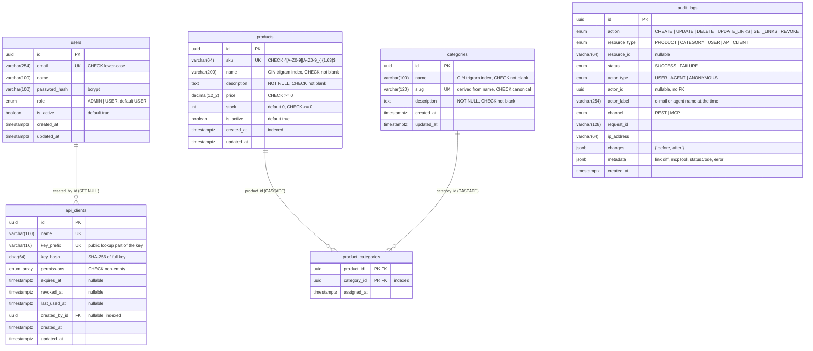

# Database design

PostgreSQL 16, managed by Prisma migrations in [`api/prisma/migrations`](../api/prisma/migrations).
Schema source: [`api/prisma/schema.prisma`](../api/prisma/schema.prisma). Integrity rules that
Prisma's schema language cannot express (CHECK constraints, the audit trigger) live in the
hand-written migration `20261015120100_integrity_constraints` (and `20261016090000_unicode_category_slugs`).

## Entity–relationship diagram

`audit_logs` is intentionally **not** connected to other tables (see below).

## Relationships

- **Products ↔ categories: many-to-many** through `product_categories`. A product can sit in
  several categories (a puzzle is both "Toys" and "Educational"); a category holds many products.
  - **Composite primary key** `(product_id, category_id)` makes a duplicate link impossible, and
    its leading column serves "categories of a product" lookups.
  - A separate **index on `category_id`** serves the reverse direction ("products in a category",
    the `?categoryId=` filter, product counts).
  - **`ON DELETE CASCADE` on both FKs**: deleting a product or a category removes only its *links*,
    never the entities on the other side. The audit entry of the delete records exactly which
    links disappeared (`unlinkedProductIds` / `unlinkedCategoryIds`), so nothing vanishes silently.
  - `assigned_at` records when a link was made (useful for "recently added to category").
- **Users → api_clients**: who minted an agent key. `ON DELETE SET NULL` so removing a user does
  not delete (or orphan-fail) the agents they created.

## Keys

- **UUID primary keys** everywhere: not enumerable (no guessing `/products/124` next to `/123`),
  safe to expose to agents, and generatable without a round-trip.
- **Natural unique keys** where the domain has them:
  - `products.sku`: business identifier, normalised to upper case by the API and enforced by a CHECK.
  - `categories.slug`: the *uniqueness key for names*. It is derived from the name
    (Unicode-normalised, lower-cased, punctuation collapsed), so "Home & Garden", "home garden" and
    "HOME--GARDEN" cannot coexist, while non-Latin names keep meaningful slugs (`كتب-عربية`).
    It also gives a URL-friendly identifier for future use.
  - `users.email` (stored lower-case; CHECK guarantees uniqueness is case-insensitive).
  - `api_clients.key_prefix`: O(1) key lookup without scanning hashes; `api_clients.name`.

## Constraints (defence in depth)

The API validates everything first (DTOs + business rules) and returns precise 400/409/422 errors.
The database independently guarantees the invariants, so no bug, script or future client can
store invalid data:

| Table | Constraint | Why |
| --- | --- | --- |
| products | `price >= 0`, `stock >= 0` | money/stock can never go negative |
| products | `sku ~ '^[A-Z0-9][A-Z0-9_-]{1,63}$'` | canonical SKU → uniqueness is case-insensitive |
| products, categories | `btrim(name) <> ''`, `btrim(description) <> ''` | required fields really are present |
| categories | `slug = lower(slug)` and well-formed hyphenation | the slug is a reliable uniqueness key |
| users | `email = lower(email)` | case-insensitive uniqueness |
| api_clients | `cardinality(permissions) > 0` | a key without permissions is meaningless |
| audit_logs | trigger blocks `UPDATE` / `DELETE` | the audit trail is append-only, even for the app's DB user |

## Indexes

| Index | Serves |
| --- | --- |
| `products_name_trgm_idx`, `categories_name_trgm_idx` (GIN, `pg_trgm`) | case-insensitive `contains` search (`ILIKE '%term%'`), which a B-tree cannot use |
| `products(created_at)` | recency ordering / time-window queries |
| `product_categories(category_id)` | products-in-category, link counts |
| `api_clients(created_by_id)` | FK lookups / `SET NULL` on user delete |
| `audit_logs(resource_type, resource_id)` | "history of this product/category" |
| `audit_logs(actor_type, actor_id)` | "everything this agent did" |
| `audit_logs(created_at)`, `audit_logs(status, created_at)` | time windows, "recent failures" (e.g. denied agent writes) |

Unique constraints (`sku`, `slug`, `email`, `key_prefix`, `name`) are also B-tree indexes.

## Data types

- `price` is `numeric(12,2)`, never a float: exact cents, returned by the API as a string
  (`"24.99"`) so JSON clients cannot introduce rounding errors.
- All timestamps are `timestamptz(3)` (UTC, millisecond precision).
- Enums are native PostgreSQL enums (`role`, `permission`, audit enums): invalid values are
  rejected by the database and the allowed set is self-documenting.

## The audit log design

- **No foreign keys on purpose.** Audit entries must outlive both the actor (a revoked agent, a
  deleted user) and the resource (a deleted category). `actor_label` freezes the human-readable
  identity at the time of the action.
- **Append-only** via a `BEFORE UPDATE OR DELETE` trigger that raises an error. (`TRUNCATE` is
  not a row operation and is used only by the test suite to reset the test database; in production
  the application's DB role should not hold `TRUNCATE` on `audit_logs`.)
- `changes` holds `{ before, after }` snapshots (including the full sorted set of linked ids), and
  `metadata` holds operation details: link diffs (`added`, `removed`, `alreadyLinked`,
  `notLinked`), `changedFields`, the MCP tool name, and for failures the HTTP status and error.
- Successful entries are written **in the same transaction** as the change they describe. See
  [DECISIONS.md](DECISIONS.md#audit-logging).

## Additional attributes (beyond the brief)

| Attribute | Reason |
| --- | --- |
| `products.sku` | Stable business identifier, unique; what agents and humans actually refer to |
| `products.price`, `stock`, `is_active` | Minimal realistic product data; `is_active` allows hiding without deleting (filterable) |
| `categories.slug` | Case/punctuation-insensitive name uniqueness, URL-friendly id |
| `product_categories.assigned_at` | When a product was added to a category |
| `users.is_active` | Disable an account immediately (checked on every request, no token wait) |
| `created_at` / `updated_at` | On every entity; link changes bump the category's `updated_at` |
| `api_clients.*` | Machine identities for agents: scoped permissions, expiry, revocation, last use |
